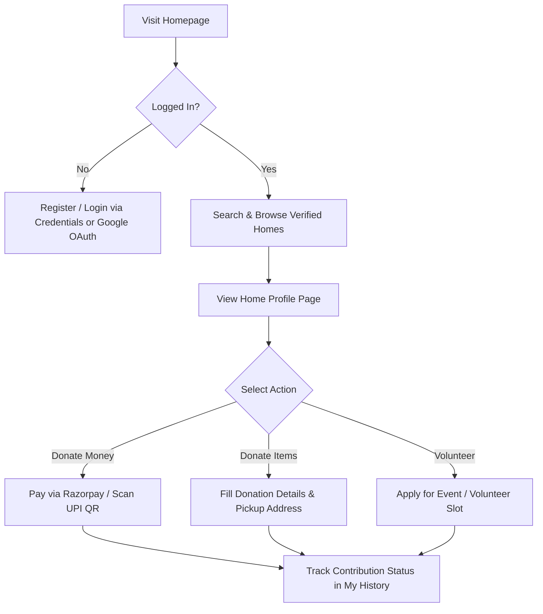
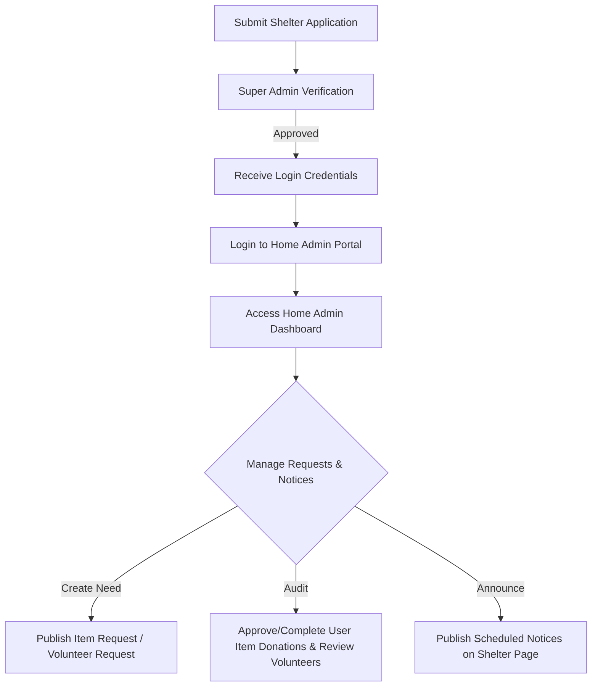
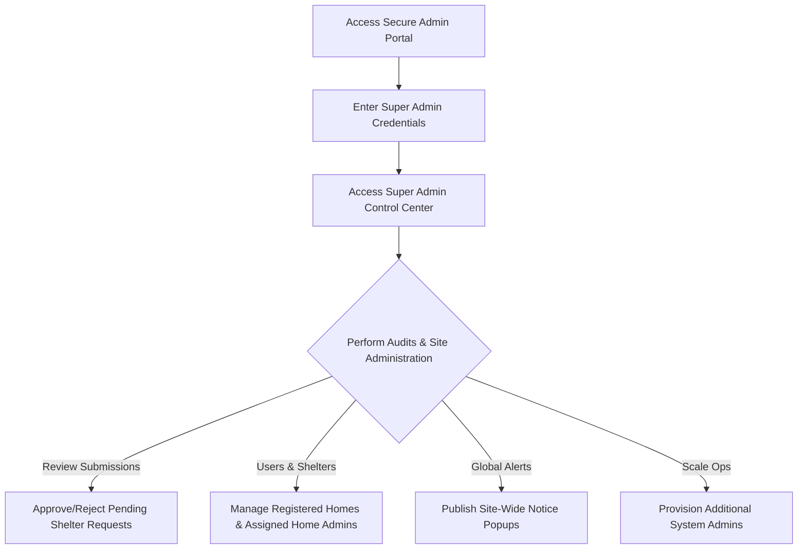
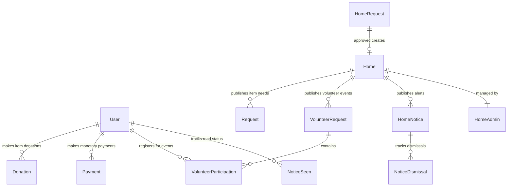

# 🕊️ CareConnect

> **Live at [careconnectofficial.vercel.app](https://careconnectofficial.vercel.app/)**

CareConnect is a professional, high-fidelity platform designed to bridge the gap between generous donors, passionate volunteers, and verified shelter homes (orphanages and old-age homes). Built using **Next.js 14 (App Router)**, **Tailwind CSS**, and **MongoDB**, it provides role-based workspaces for donors, shelter admins, and super admins to facilitate secure monetary donations (via Razorpay and direct UPI), item contributions, and volunteering event coordination.

---

## 🛠️ Tech Stack & Key Technologies

| Technology | Purpose | Description |
| :--- | :--- | :--- |
| **Next.js 14** | Core Framework | Utilizes React Server Components (RSC) and client-side caching for fast rendering. |
| **Tailwind CSS** | Styling System | Features premium dark modes, gradient accents, frosted glassmorphism overlays, and interactive hover effects. |
| **MongoDB & Mongoose** | Database & ORM | Implements structured schemas for users, shelter registrations, notices, payments, and event registrations. |
| **Razorpay API** | Payment Gateway | Implements secure merchant-level transactions with verification signatures. |
| **UPI deep-linking** | Mobile Payments | Generates automatic `upi://pay` URI schemes along with base64-encoded QR codes. |
| **JWT & NextAuth.js** | Authentication | Supports manual credentials and Google OAuth with role-restricted token validation. |

---

## 👥 Roles & System Workflows

CareConnect operates on a strict Role-Based Access Control (RBAC) mechanism. Below are the workflows and interface capabilities for each user type:

### 1. Standard User (Donor / Volunteer)
The standard user experience centers on discovery, donation, and volunteer engagement.

#### 🔄 User Flow:


#### 🖥️ Interface Details & Features:
*   **Search and Discovery Panel:** A search engine allowing donors to filter verified homes by Name, Location, or Type (`orphanage` vs `oldage`).
*   **Shelter Profiles:** Details the shelter's mission, location, current requirements, and contact channels.
*   **Flexible Donations:**
    *   **Monetary:** Standardized integration with Razorpay checkout and a UPI modal displaying the shelter's custom VPA QR code (supporting mobile deep links).
    *   **In-Kind/Items:** Allows users to donate items (e.g. food, clothing, books) by specifying categories, quantity, and a physical pickup address.
*   **Volunteer Portal:** Lists event listings published by shelters, letting users join with a single click.
*   **Announcements HUD:** Features site-wide popups from Super Admins and specific shelter updates from Home Admins with smart dismissal tracking to prevent repetitive popups.
*   **Personal Ledger:** A history log detailing monetary donation statuses, item pickup progress (Pending, Accepted, Completed), and registered volunteering events.

---

### 2. Orphanage/OldAgeHome Admin (Home Admin)
Home Admins oversee shelter operations, manage user donations, and schedule targeted alerts for their specific shelter.

#### 🔄 User Flow:


#### 🖥️ Interface Details & Features:
*   **Digital Onboarding:** Enables new shelters to apply by providing administrative credentials, official documentation URLs, and UPI payment details.
*   **Management Dashboard:**
    *   **Need Publisher:** Post item donation requests (specifying category, name, and amount) and volunteer events (specifying datetime, location, and volunteer headcount).
    *   **Received Item Ledger:** Tracks user donations. Admins can update status states (`Pending` ➡️ `Accepted` ➡️ `Completed`).
    *   **Volunteers Registry:** Displays lists of registered volunteers for scheduled events.
*   **Shelter Notices Panel:**
    *   Schedule notices with `startAt` and `endAt` dates.
    *   Configure notices with priority status (`high`, `medium`, `low`) and `showOnce` dismissible alerts.

---

### 3. Super Admin
Super Admins act as the compliance and oversight body, managing system configuration and approving new shelter listings.

#### 🔄 User Flow:


#### 🖥️ Interface Details & Features:
*   **Administrative Access:** An isolated, secure login page for authorized administrative staff.
*   **Control Center:** Displays platform analytics (total users, verified shelters, ongoing donation cycles, and global metrics).
*   **Verification Queue:** Review pending onboarding registrations. Approving creates the shelter entry and corresponding Home Admin credentials.
*   **Directory Management:**
    *   **Shelters Registry:** Direct update/edit controls for all registered shelter entries.
    *   **Admins Registry:** Manage administrative users linked to individual shelters.
*   **Site-Wide Notice Manager:** Publish priority notices across all system views. Supports custom duration, enabling/disabling, priority-based coloring, and frequency constraints.

---

## 🗄️ Database Schema Relationships

CareConnect uses Mongoose models to handle data relationships:



### Schemas Summary:
1.  **`User`** — Supports password login and Google OAuth.
2.  **`Home`** — Contains shelter type, description, and payment details.
3.  **`HomeAdmin`** — Linked to a specific Home for workspace management.
4.  **`HomeRequest`** — An onboarding application containing document uploads and contact info.
5.  **`Donation`** — Represents physical item offerings with pickup details and status tracking.
6.  **`Payment`** — Logs monetary donations via Razorpay.
7.  **`Request`** — Item requests published by shelters.
8.  **`VolunteerRequest`** — Scheduled volunteering events published by shelters.
9.  **`VolunteerParticipation`** — Links Users to Volunteer events with a unique index to prevent duplicate sign-ups.
10. **`Notice` & `NoticeSeen`** — Site-wide announcements and their read status logs.
11. **`HomeNotice` & `NoticeDismissal`** — Shelter-specific alerts and their dismissal logs.

---

## 📁 Project Structure

```
Care-Connect-main/
├── app/
│   ├── admin/                # Super Admin pages
│   │   ├── dashboard/        # Global analytics & management
│   │   ├── home-requests/    # Onboarding approval flow
│   │   ├── notices/          # Global notices dashboard
│   │   └── homes/            # Shelter details editor
│   ├── home-admin/           # Home Admin pages
│   │   └── dashboard/        # Needs registry, donations, & volunteers
│   ├── homes/                # Public view of verified homes
│   │   └── [id]/             # Home profiles & donation modals
│   ├── user/                 # Standard User accounts
│   │   ├── history/          # User contribution log
│   │   ├── login/
│   │   └── register/
│   ├── components/           # Reusable UI elements (Navbar, Modals, Popups)
│   └── api/                  # RESTful API routes
├── models/                   # Mongoose schema definitions
├── lib/                      # Auth utilities & database connector
└── public/                   # Static assets
```

---

## 📦 Deployment

CareConnect is deployed on **Vercel** and is live at **[careconnectofficial.vercel.app](https://careconnectofficial.vercel.app/)**.

---

## 📄 License

This project is licensed under the **MIT License**.

---

<div align="center">

Made with ❤️ using **Next.js**, **MongoDB**, and **Razorpay**

⭐ Star this repo if you found it useful!

</div>
